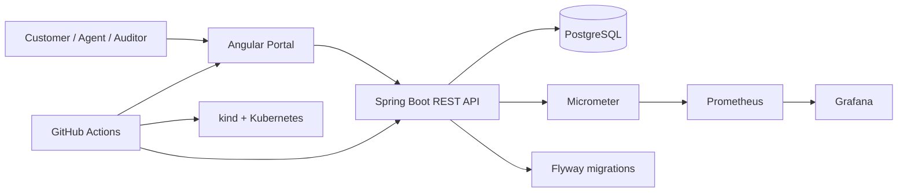

# Consent Management Lab

A portfolio project demonstrating consent lifecycle management for an insurance context.

> **Synthetic-data notice:** Every record, name, identifier and example in this repository is synthetic. No real customers or personal data are used.

## Status

CI has run on GitHub Actions and the blocking jobs are green. The numbers in **Results** are taken from that run ([latest CI run](https://github.com/hamza2829/consent-management-lab/actions/runs/45710025667)). Three jobs (SonarQube, Playwright e2e, kind deploy) are kept but run **non-blocking** — see **CI**.

## Architecture

## Domain

- Customers own consent records.
- Purposes: marketing, partner data sharing, and profiling.
- Consent events are versioned as `GIVEN`, `CHANGED`, or `WITHDRAWN`.
- Audit events are append-only and record timestamp, actor and reason.
- GDPR-style export returns JSON. Deletion is implemented as anonymisation while retaining the minimum audit evidence required by the documented policy.

## Retention policy (demonstration only)

A deletion request anonymises customer-identifying fields and preserves consent-event/audit metadata for **six years** as a configurable illustrative retention period. This is a portfolio assumption, not legal advice and not a statement of any insurer's actual policy. Review applicable law, contractual duties and the organisation's approved retention schedule before real use.

## Repository layout

- `backend/` — Java 21, Spring Boot 3, PostgreSQL, Flyway, OpenAPI and tests.
- `frontend/` — Angular portal starter.
- `api-tests/` — Bruno collection.
- `e2e/` — Playwright starter.
- `.github/workflows/` — CI pipeline.
- `k8s/` — Kubernetes manifests.
- `grafana/` — dashboard JSON.
- `.claude/skills/` — repeatable Claude Code task guides.

## Local development

The intended development environment is Java 21, Node.js 20+, npm, Maven and Docker Compose. This repository does not require local execution for its GitHub Actions workflow, but local verification is useful when available.

Backend: `cd backend && ./mvnw test`
Frontend: `cd frontend && npm ci && npm test -- --watch=false`
E2E: `cd e2e && npm ci && npx playwright test`

## CI

Blocking jobs — these gate the pipeline and are green:

- **backend** — Maven `verify` against a PostgreSQL service, Flyway migrations, JUnit 5 tests and JaCoCo coverage.
- **frontend** — Angular production build.
- **api-tests** — starts the backend and runs the Bruno HTTP smoke check against `/actuator/health`.

Non-blocking jobs — kept for completeness and allowed to fail via `continue-on-error`, so they do not fail the pipeline:

- **sonar** — SonarQube needs a server and token (no accounts/keys in this lab), so it is a placeholder.
- **e2e** — Playwright needs the Angular portal served; not wired to a running portal in CI.
- **manifests** — `kubeconform` plus a `kind` cluster and image pulls are heavy and image-dependent.

## Results

| Measure | Result |
|---|---|
| Backend tests (JUnit 5) | 3 passed, 0 failed |
| Backend coverage (JaCoCo) | 68.15% instructions (276/405) |
| API smoke test (Bruno) | Passed — GET /actuator/health returns 200 |
| SonarQube quality gate | Not enforced — placeholder job (non-blocking) |
| kind deployment | Non-blocking — not asserted in CI |

## Honest limitations

- All data is synthetic; no real customers are represented.
- The kind cluster is ephemeral and exists only in CI.
- This is an educational portfolio project, not production-ready insurance software.
- This is not a legal opinion on GDPR. Retention, lawful basis, erasure exceptions, identity verification and operational controls require qualified review.
- SonarQube, Playwright e2e and kind deployment run as non-blocking jobs; they are not part of the green gate.
