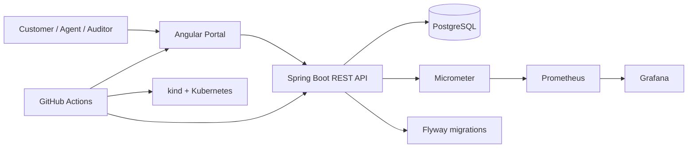

# Consent Management Lab

A portfolio project demonstrating consent lifecycle management for an insurance context.

> **Synthetic-data notice:** Every record, name, identifier and example in this repository is synthetic. No real customers or personal data are used.

## Status

This archive is a source scaffold, not a verified release. CI measurements are intentionally marked **Not measured** until the GitHub Actions pipeline has actually run. No coverage, test-count, SonarQube or deployment result is claimed here.

## Architecture

## Domain

- Customers own consent records.
- Purposes: marketing, partner data sharing, and profiling.
- Consent events are versioned as `GIVEN`, `CHANGED`, or `WITHDRAWN`.
- Audit events are append-only and record timestamp, actor and reason.
- GDPR-style export returns JSON. Deletion is implemented as anonymisation while retaining the minimum audit evidence required by the documented policy.

## Retention policy (demonstration only)

A deletion request anonymises customer-identifying fields and preserves consent-event/audit metadata for **six years** as a configurable illustrative retention period. This is a portfolio assumption, not legal advice and not a statement of any insurer's actual policy. Review applicable law, contractual duties and the organisation's approved retention schedule before real use.

## Repository layout

- `backend/` — Java 21, Spring Boot 3, PostgreSQL, Flyway, OpenAPI and tests.
- `frontend/` — Angular portal starter.
- `api-tests/` — Bruno collection.
- `e2e/` — Playwright starter.
- `.github/workflows/` — CI pipeline.
- `k8s/` — Kubernetes manifests.
- `grafana/` — dashboard JSON.
- `.claude/skills/` — repeatable Claude Code task guides.

## Local development

The intended development environment is Java 21, Node.js 20+, npm, Maven and Docker Compose. This repository does not require local execution for its GitHub Actions workflow, but local verification is useful when available.

Backend: `cd backend && ./mvnw test`
Frontend: `cd frontend && npm ci && npm test -- --watch=false`
E2E: `cd e2e && npm ci && npx playwright test`

## CI

The workflow is designed to build/test the backend and frontend, execute Bruno and Playwright, run SonarQube analysis, validate Kubernetes manifests with kubeconform, deploy to kind and run an HTTP smoke check. Service-container and runner-image compatibility may require adjustments after the first GitHub Actions run.

## Results

| Measure | Result |
|---|---|
| Automated tests | Not measured — run CI |
| Backend coverage | Not measured — run CI |
| SonarQube quality gate | Not measured — run CI |
| kind deployment smoke test | Not measured — run CI |

## Honest limitations

- All data is synthetic; no real customers are represented.
- The kind cluster is ephemeral and exists only in CI.
- This is an educational portfolio project, not production-ready insurance software.
- This is not a legal opinion on GDPR. Retention, lawful basis, erasure exceptions, identity verification and operational controls require qualified review.
- CI has not been executed from this archive; no green status is implied.
